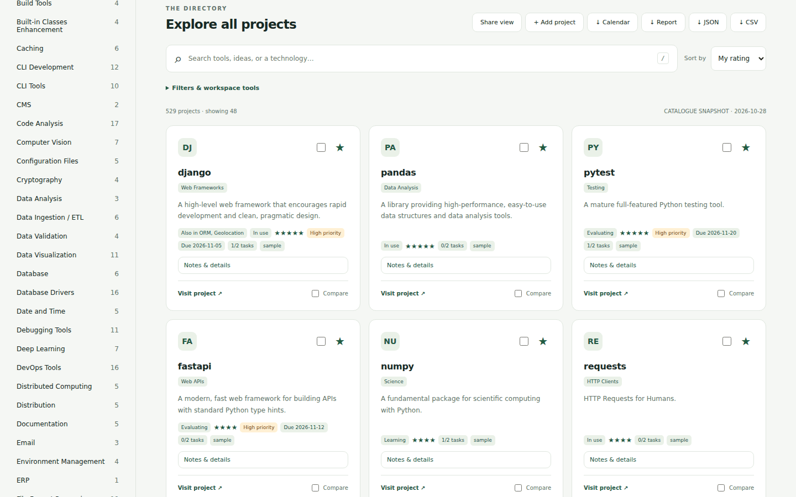
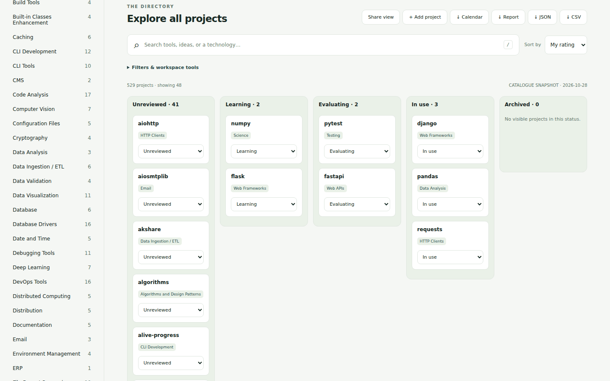
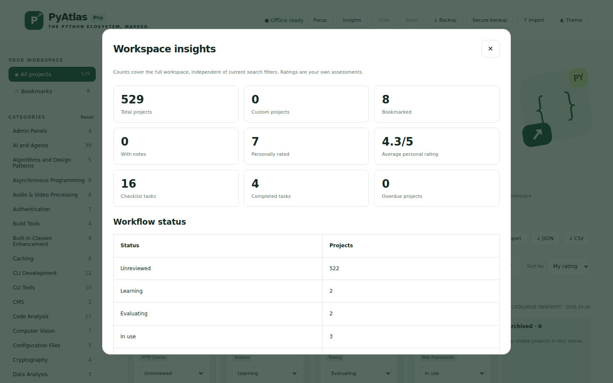
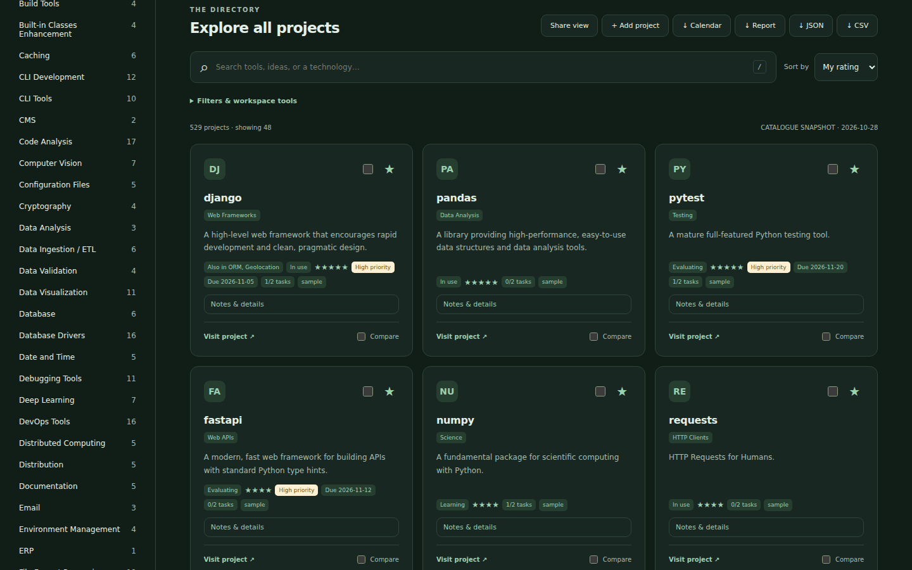
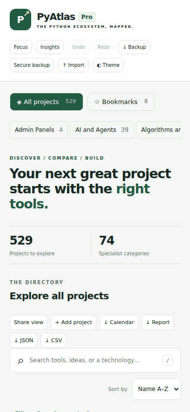

# PyAtlas Pro 8.0 — Visual Edition, English-only

Native offline charts/graphs, architecture and workflow diagrams, and project
image galleries now extend the professional toolkit. Open **Charts & Diagrams**
for workspace charts and exportable SVG diagrams. Use **Images & diagrams** on
any project for its gallery, local screenshot upload and suggested architecture.

Official FastAPI documentation and Matplotlib example images are bundled with
source/license attribution. Other project images are explicitly labelled
illustrations. Uploaded screenshots/history are included in Complete Backup.

Read [the visual guide](docs/V8-GUIDE.md) and [validation](docs/VALIDATION.md).

## Professional toolkit

Six professional tools extend the offline workspace:

- Project Starter: a downloadable source ZIP with CLI, pytest, Docker and CI.
- Compatibility checks: offline pin validation, online Requires-Python metadata,
  and an optional real pip dry-run resolver for the running interpreter/OS.
- Security/license reports: explicit-button PyPI + OSV checks and cached results.
- Custom learning paths: create, reorder and preserve completed steps.
- Complete encrypted backup: workspace, settings, paths, caches and assessments.
- Advanced comparison: personally weighted criteria, ratings, notes and exports.

**Start with [the professional tools guide](docs/V7-GUIDE.md).** Browser features
work without Node or Python after opening the built page. The optional full
resolver requires Python and `python -m pip install ".[audit]"`; online operations
require an explicit action. No packages are installed by the checker.

## Previous core features

An installable offline-first Python ecosystem workspace. Includes opt-in GitHub
metadata, verified-name dependency drafts, English-only UI, typo-tolerant
search, a command palette, two 30-day learning plans, local-only usage counters,
Docker, MkDocs and tag-based releases with PyPI trusted publishing.

```sh
python -m pyatlas serve
```

Open **http://localhost:8765** and wait for **Offline cache ready**. Install through
your browser menu. For a portable offline file open `dist/index.html` directly;
PWA installation requires HTTPS or localhost. Live GitHub refresh and external
project websites require internet and are never fetched automatically.

**Read the [v6 guide](docs/V6-GUIDE.md), [release setup](docs/RELEASES.md), and
[validation results](docs/VALIDATION.md).** The older feature documentation below
remains relevant to workspace schema 4. The interface and supplied documentation are English-only. Personal project data
and workspace backups remain compatible.

## Docker

```sh
docker build -t pyatlas-pro:8.0.0 .
docker run --rm -p 127.0.0.1:8765:8080 pyatlas-pro:8.0.0
```

## Documentation site

```sh
python -m pip install ".[docs]"
python -m mkdocs serve
```

## Shortcuts and quality

`/` focuses search; Ctrl+K / Cmd+K opens commands. Use bulk checkboxes then Stack
Builder to export `requirements.txt` or `pyproject.toml` drafts. Learning progress
and usage counters have separate export buttons, in addition to workspace backup.
Usage recording is off by default. No telemetry is sent.

```sh
npm ci
npx playwright install chromium
npm test
npm run test:v6
npm run audit:lighthouse
```

Release automation is provided, with one-time repository/PyPI configuration
required. No GitHub Release, PyPI upload, or deployment has been performed here.

---

# PyAtlas Pro 5.3

**Discover your Python stack. Save your shortlist. Compare your options.**



## Live demo

The repository includes a GitHub Pages workflow (`.github/workflows/pages.yml`). To publish your own copy: push to the `main` branch, then in the repository go to **Settings → Pages** and set **Source** to **GitHub Actions**. The demo will be served at `https://<your-user>.github.io/<your-repo>/`. It is the same offline page as `dist/index.html`; your notes and bookmarks stay in each visitor's own browser.

## Screenshots

Screenshots show a built-in sample workspace, not real personal data, and are regenerated by `python tools/capture_screenshots.py` (needs `pip install playwright` and `playwright install chromium`).

| Workflow board | Insights |
| --- | --- |
|  |  |

| Dark theme | Mobile |
| --- | --- |
|  |  |

PyAtlas Pro turns a Markdown resource directory into a portable, offline-first developer workspace. The new application includes **529 catalogue entries across 74 categories**, a responsive dashboard, browser bookmarks, three-project comparison and a Python command-line interface. Version 2 added an editable personal workspace with custom projects, notes, tags, collections, ratings and workflow statuses.

## New in 5.3

- **Shareable view links:** the address bar follows your search, category, sort and filters (for example `#q=django&sort=rating`). Use **Share view** to copy it; pasting such a link restores that view. Links carry only search and filter choices, never notes, tasks, ratings or backups. For links others can open, host the page (see Live demo).
- **Tag filter and clickable tags:** filter by any tag you have added, from the Filters panel or by clicking a tag on a card. Saved searches remember the tag.
- **Duplicate awareness:** projects whose URL is listed in more than one category show an "Also in …" badge, and adding a custom project with an existing URL asks you to confirm.
- **System theme and print:** first visit follows your operating-system light/dark setting (your explicit choice wins afterwards); reduced-motion preferences are respected; printing produces a clean two-column project list.

## New in 5.2

- **Hash-based Content-Security-Policy:** every built page carries a policy that allows only its own inline script and style, blocks all network requests and forbids embedding. See `SECURITY.md`.
- **GitHub Pages live-demo workflow** and README screenshots from a real Chromium run with no console errors.
- Page icon, theme colour and no-referrer policy.

## New in 5.0

- **Secure backup:** download a password-protected workspace using AES-256-GCM with a fresh random salt and nonce, and a PBKDF2-SHA256 password-derived key (600,000 iterations). Enter and confirm a password of at least 12 characters. The password is not stored by the application. There is no password recovery. Encryption protects that downloaded file; browser storage, reports, calendar files and ordinary JSON/CSV exports remain unencrypted.
- **Encrypted restore:** select a protected JSON file through **Import**, unlock it locally, review the import impact, then choose **Merge workspace**. A wrong password or changed ciphertext fails without applying imported data. Web Crypto must be available; use localhost or HTTPS in a supported browser if local-file encryption is unavailable.
- **Focus workspace:** see non-archived projects with incomplete tasks, overdue dates or deadlines within seven days, across the entire workspace. Overdue projects come first, followed by upcoming deadlines and other pending tasks, with priority and date ordering. Check a task to save it immediately; open its project name for the full editor. A project can remain visible after its tasks are complete if its target deadline is still due.
- **Calendar export:** download matching, non-archived project deadlines as `.ics` all-day events with stable project IDs. Calendar files contain project names, categories, workflow status, priority and project URLs; private notes and checklist text are excluded. Import the file into a compatible calendar app yourself. This is a snapshot, with no live sync or added alarms. Calendar apps may create duplicates when repeatedly importing the same file.
- **Import impact preview:** see how many custom projects, existing project workspaces and saved-search names will be replaced before merging. New bookmarks are counted separately. Matching entries still use the imported version, so export your current backup first if both versions matter.

Version 8 keeps **workspace schema 4**: plain v4 backups work, along with schema-2/3 migration. Encrypted backup envelopes are a separate format supported by version 5. Plaintext portable backups are limited to 8 MB; encrypted imports accept envelope files up to 16 MB containing at most 8 MB of decoded workspace data. Ordinary backups retain their existing unencrypted format.

## New in 4.0

- **Project planner:** each project's Notes & details editor includes Low/Normal/High priority, a target deadline and up to 50 checklist tasks. Check tasks off, remove them, then choose **Save project** to persist changes. Closing without saving discards checklist edits.
- **Deadline filters:** show overdue projects, deadlines within the next seven days (including today), or projects without a deadline. These are project target dates, independent of workflow status. They use the browser's local calendar date; no reminders or background scheduling are created.
- **Planning sorts:** sort by priority, earliest deadline (undated last), or highest personal rating.
- **Advanced browser search:** quote exact phrases such as `"web framework"`, exclude text with `-django`, and search across checklist tasks as well as descriptions and personal metadata. Positive terms must all match. The CLI retains its simpler all-word catalogue search.
- **Progress reports:** export the entire current filtered result as Markdown with project links, status, rating, priority, deadline, collections and checklist progress. Private notes are omitted unless you explicitly select **Include private notes**. Tasks and other metadata may also be personal; review reports before sharing. Reports are not workspace backups.
- **Mobile workspace:** a compact header area and a collapsible **Filters & workspace tools** panel keep the directory easier to reach on small screens. Open that panel to use advanced filters, saved searches or bulk tools.
- **Verified browser workflows:** an actual Chromium integration run covers editor persistence, search, filters, reports, bookmarks, comparison, custom projects, bulk updates, Undo/Redo, board moves, saved searches, backup migration, theme and responsive layout checks.
- **Backup compatibility:** schema-2 and schema-3 workspaces migrate to schema 4 with safe planner defaults. New backups include tasks and planning filters; older application versions cannot import schema-4 backups.

## New in 3.0

- **Workflow board:** view filtered results in Unreviewed, Learning, Evaluating, In use and Archived columns. Change status with each tile's dropdown; keyboard users have the same control. The board shows the current visible result batch; **Load more projects** adds more.
- **Bulk updates:** use the checkbox in a card header or **Select all matches**, then choose a status and/or collection and apply. Selection persists across filters, so the selection count may include hidden entries. **Select all matches** includes the entire filtered result, beyond the visible batch. Adding a collection preserves existing memberships, notes and ratings.
- **Undo / Redo:** reverse workspace mutations including edits, deletion, bookmark changes, imports, bulk changes and saved-search updates. Keep up to 20 previous workspace states during the current session. New changes clear the redo stack. Reloading clears history; history is not included in backups. Search filters, selection and layout are not undoable workspace data.
- **Saved searches:** save a name for your query, category, bookmarks-only choice, source, workflow status, collection, minimum rating and sort order. Restore it from the dropdown. Up to 50 named searches are included in workspace backups; reusing a name replaces its filters. Matching names from imported backups replace existing saved searches.
- **Workspace insights:** review full-workspace totals, bookmarks, notes, personal-rating average, status counts and the ten largest categories. Counts reflect local data, independent of current filters, and do not make live quality or popularity claims.
- **Compatible migration:** schema-2 backups and browser workspace data migrate to the current schema 4. Existing version-1 bookmarks remain supported. Data still stays in the current browser unless you export a backup.

## New in 2.0

- **Custom projects:** add, edit and delete your own tools with validated HTTP(S) links. Bundled catalogue fields stay read-only.
- **Project workspace:** open **Notes & details** to save private notes, tags, collections, workflow status and a personal rating (0–5).
- **Collections:** enter comma-separated names such as `Learning plan, Next stack`. Filter by collection; remove a collection name from all assigned projects to remove it from the filter.
- **Advanced filters:** combine search, category, bookmarks, status, collection, project source and minimum personal rating. Search also includes notes, tags and collection names.
- **List view:** switch between compact list and card layouts.
- **Portable backups:** use **Backup** to export custom projects, notes, tags, collections, ratings, statuses and bookmarks. Use **Import** to validate and preview a backup, then explicitly merge it. Imported values win for matching IDs; unrelated data remains intact. Export your current backup before merging if you need both versions.
- **Migration:** browser bookmarks from version 1 are read automatically when no version 2 workspace exists at the same browser origin.

Workspace data is saved in your current browser, with no account or cloud sync. **Backup files contain your private notes**: keep them somewhere appropriate. Ordinary catalogue JSON/CSV exports contain matching project fields, including custom projects, but omit personal notes and ratings; they are different from a workspace backup and cannot be imported as one. The generic export's CC BY licence metadata applies to adapted bundled catalogue material; adding a custom project does not change its ownership or its own licence.

The dashboard does not encrypt local browser data or ordinary backups. Use **Secure backup** for a password-protected downloaded copy. Theme preference is device-local and is not included in workspace backups. Import accepts schema-2, schema-3 and schema-4 plaintext workspace JSON up to 8 MB, plus version-5 encrypted envelopes up to 16 MB (8 MB decoded limit). New backups use schema 4 and include saved searches and planner data; older app versions cannot restore them. Personal ratings and statuses are your own assessments, not verified quality scores.

## Open it immediately

Extract this ZIP, then open **`dist/index.html`** in a modern browser. No installation, login, API key or subscription is required. All application styles, scripts and catalogue data are embedded in that one HTML file. You can copy it between devices. External project links still need internet access.

On Android, extract the ZIP first and open the HTML file in a browser that permits local JavaScript. Some file-manager previews restrict scripts or downloads; use the local-server route if your browser cannot open it properly.

## Run locally with Python

Python **3.10 or newer** is required. No runtime dependencies are needed.

```bash
cd PyAtlas-Pro
python -m pyatlas serve
```

Open **http://127.0.0.1:8765**. Press Ctrl+C to stop.

- Windows: double-click `launch_windows.bat`, then open the address above.
- Linux / macOS / Kali: run `sh launch_unix.sh`.
- Android with Python already installed in Termux: run `python -m pyatlas serve` inside the extracted project directory and open the local address in your browser.

The server binds to loopback and serves only a temporary generated dashboard directory. It does not expose your project source tree. It is a local preview server, not an authenticated public service.

## Features

| Capability | Included behavior |
| --- | --- |
| Advanced browser search | Positive terms, quoted phrases and exclusions across project fields, notes, tags and tasks |
| Category navigation | 74 categories, counts and reset control |
| Bookmarks | Save entries locally in the current browser and origin |
| Comparison | Select two or three projects and compare catalogue fields |
| Exports | Download the full filtered result set as JSON or CSV |
| Dark theme | Toggle theme and persist the choice when storage is available |
| Accessible controls | Labels, keyboard focus, status announcements, skip link and reduced-motion support |
| Portable dashboard | Self-contained generated HTML with no CDN, remote font or tracking |
| CLI | Search, validate, inspect statistics, export, build and serve |
| CI | GitHub Actions configuration for Linux/Windows and Python 3.10, 3.12 and 3.14 |

Press `/` to focus search. Up to 48 results render initially; **Load more projects** reveals additional matches. Exports include all matching entries, including entries beyond the visible page. Comparison selection persists while filtering during the session.

## Command-line examples

```bash
python -m pyatlas stats
python -m pyatlas validate
python -m pyatlas search "web framework"
python -m pyatlas search django --format json
python -m pyatlas search "" --category "Data Analysis" --format csv
python -m pyatlas build --output dist
python -m unittest discover -s tests -v
npm test
```

Optionally install a command into your Python environment with `python -m pip install .`, then use `pyatlas stats` or `pyatlas serve`. Installing may need internet access for build tooling; running from source does not.

## Project layout

```text
PyAtlas-Pro/
  pyatlas/
    catalog.py          Catalogue validation, search and CSV export
    builder.py          Standalone dashboard generation
    __main__.py         Command-line tools and local preview server
    assets/             HTML, CSS, UI and shared workspace validation
    data/catalog.json   Structured, attributed source snapshot
  dist/index.html       Ready-to-open dashboard
  tests/                Automated regression tests
  docs/                 Architecture, quick start, migration and attribution
  .github/              CI workflows, Dependabot, issue and PR templates
  launch_windows.bat
  launch_unix.sh
  pyproject.toml
```

## Catalogue provenance and limits

The catalogue is adapted from the uploaded Awesome Python snapshot at commit `91e199ced625716e7e7e421fb1750206226e2bcf`, dated 2026-10-28 in the supplied ZIP. Category names, entry descriptions and project URLs are imported source content, **not independently reverified recommendations**. Repeated listings in different specialisms are retained and receive distinct IDs. The complete upstream README is preserved as `docs/UPSTREAM-CATALOG.md` for provenance, including its historical sponsor text; that sponsor material is not used in the application.

This release provides local exploration. It does not fetch live stars, downloads, dependency versions, licence changes or project health. It does not install or execute any listed third-party package. Browser bookmarks are not cloud-synced and may be unavailable in private browsing or restrictive local-file environments. Changing the host or port creates a separate browser-storage origin.

## Development and licensing

Edit `pyatlas/data/catalog.json`, run validation and tests, then rebuild `dist/index.html`. See `CONTRIBUTING.md` and `docs/ARCHITECTURE.md`.

The new application code is MIT-licensed. Adapted catalogue material and the upstream README remain **CC BY 4.0**, credited to Vinta Chen and contributors. See `LICENSE`, `LICENSE-CONTENT.md` and `NOTICE.md`. PyAtlas Pro is an independent adaptation; it does not claim endorsement from the upstream project or ownership of third-party projects.

## Optional browser regression tests

Node tooling is used for development tests only. Opening the dashboard and running the Python application do not need Node or npm.

```bash
npm ci
npx playwright install chromium
python -m pyatlas build --output dist
npm run test:browser
```

The automated browser test uses an isolated browser context and tests the generated HTML through a local file URL. Set `PYATLAS_BROWSER_EXECUTABLE` only when using an independently supplied Chromium executable. Browser tests are also configured as a separate GitHub Actions job; local validation does not imply that CI has already run.
